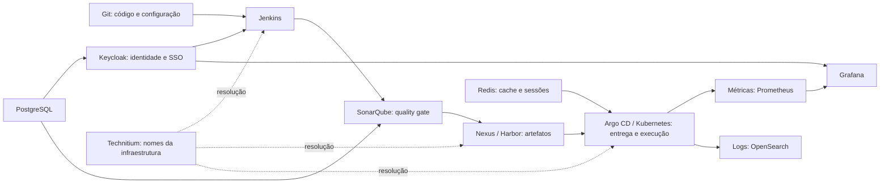

# Infraestrutura para o SDLC

Instalação nativa em **Ubuntu Server 26.04 LTS, amd64**, com binários oficiais, pacotes APT oficiais do Ubuntu, serviços systemd, Nginx, TLS e UFW. Os artefatos são baixados previamente para uma pasta servida pelo Apache HTTPD no CDN local. **Não utiliza Docker.**

## Sumário dos serviços

| Serviço | Responsabilidade no fluxo de SDLC | Situação |
| --- | --- | --- |
| [Technitium DNS](technitium/README.md) | Nomes estáveis para ferramentas, CDN e aplicações em todos os ambientes | Instalador, configuração e desinstalador nativos |
| [Jenkins](jenkins/README.md) | Integração contínua: builds, testes, análise e publicação | Instalador e desinstalador nativos |
| [SonarQube](sonarqube/README.md) | Qualidade, vulnerabilidades e quality gates do código | Instalador e desinstalador nativos |
| [Nexus](nexus/README.md) | Repositório de dependências e artefatos, como Maven/npm | Instalador e desinstalador nativos |
| [Harbor](harbor/README.md) | Registro OCI, imagens, charts e análise de vulnerabilidades | Pendente: exige containers na distribuição suportada |
| [Argo CD](argocd/README.md) | Entrega contínua GitOps no Kubernetes | Pendente: depende do cluster |
| [Kubernetes](kubernetes/README.md) | Orquestração e execução das aplicações | Reservado para reutilizar outro projeto |
| [Keycloak](keycloak/README.md) | Identidade, autenticação e SSO com OIDC/SAML | Instalador e desinstalador nativos |
| [PostgreSQL](postgresql/README.md) | Persistência relacional de aplicações e serviços | Pacotes oficiais Ubuntu 26.04 |
| [Redis](redis/README.md) | Cache, sessões e estruturas de dados em memória | Pacotes oficiais Ubuntu 26.04 |
| [Prometheus](prometheus/README.md) | Coleta e retenção de métricas | Instalador e desinstalador nativos |
| [Grafana](grafana/README.md) | Dashboards e visualização de métricas | Instalador e desinstalador nativos |
| [OpenSearch](opensearch/README.md) | Indexação e pesquisa de logs/eventos | Instalador e desinstalador nativos |

O [instalador remoto](installer/README.md) abre um terminal interativo com menu e formulários para cadastrar VMs, preparar serviços, revisar/instalar e verificar. O histórico permite retomar execuções escolhendo um item da lista. No Windows, [start.cmd](installer/start.cmd) abre o menu com dois cliques. Os comandos de cadastro, descoberta, SSH/sudo, instalação e remoção continuam disponíveis para automação. O pacote usa uv, TOML e lockfile, com build de wheel/sdist, saída JSON e logging com rotação e ocultação de segredos.

## Como os serviços se relacionam



O desenho apresenta integrações possíveis. Os instaladores não configuram automaticamente pipelines, realms, OIDC, datasources, shippers de logs ou deployments. Essas ligações exigem credenciais e decisões próprias do ambiente.

## Por onde começar

1. Prepare os downloads em Ubuntu 26.04, seguindo [CDN: preparação, verificação e publicação](docs/cdn.md). A saída fica em `artifacts/cdn/ubuntu26-amd64/`.
2. Publique a pasta no Apache HTTPD do CDN local e entregue `manifest.json` às VMs por um canal confiável. O manifesto contém os SHA256 esperados; não é baixado silenciosamente junto com o binário.
3. Prepare DNS, IP fixo, certificado e redes de acesso. Consulte a [matriz de portas](docs/ports.md) e o [guia Linux](docs/linux.md). O [Technitium](technitium/README.md) fornece o DNS interno: instale e teste antes de mudar o DNS distribuído pelo DHCP. Para baixar seus próprios artefatos, use o DNS existente ou uma entrada hosts para o CDN.
4. Instale PostgreSQL antes de Keycloak/SonarQube. Crie bancos e usuários separados conforme os exemplos dos respectivos guias.
5. Instale cada serviço pelo seu README. Prefira uma VM por serviço; portas locais distintas também permitem compartilhar uma VM, desde que haja capacidade.
6. Configure as integrações do seu fluxo e valide backup/restore antes de usar dados importantes.

Para operar uma VM remotamente, siga o [README do instalador](installer/README.md). Para executar diretamente na VM, a partir da raiz do projeto:

```bash
cp grafana/linux/.env.example grafana/linux/.env
nano grafana/linux/.env
sudo bash grafana/linux/install.sh --config "$(pwd)/grafana/linux/.env"
```

## Contrato dos instaladores

- Suporte atual: Ubuntu Server **26.04 LTS amd64 com systemd**. Outras LTS e ARM não foram habilitadas.
- CDN atual: Apache HTTPD em `192.168.0.200`, DNS `cdn.trendsoftware.brasil`. HTTP privado exige `ALLOW_HTTP_ARTIFACTS=true` e manifesto entregue por SSH/SFTP; os downloads são verificados por SHA256.
- Aplicações HTTP: cliente → Nginx HTTPS/443 → serviço em `127.0.0.1`. Porta 80 somente redireciona para HTTPS.
- PostgreSQL: Nginx TCP/5432 com TLS nativo do PostgreSQL. Redis: Nginx TLS/6380. Ambos exigem CIDRs restritos.
- Technitium: consultas diretas em 53/TCP e UDP no IP privado da VM, restritas a `DNS_CIDRS`; somente o painel passa pelo Nginx. O resolvedor do Ubuntu é preservado.
- UFW libera SSH antes de ser ativado e cria regras específicas por serviço; Nginx também aplica a lista de redes.
- Cada serviço tem usuário sem login, unit `sdlc-<serviço>.service`, configuração em `/opt/sdlc/<serviço>/` e dados em `/var/lib/sdlc/<serviço>/`.
- A desinstalação padrão apaga os dados do serviço e exige `--yes`. `--keep-data` preserva dados e segredos para reinstalação.
- Pacotes Ubuntu, cache compartilhado, regras SSH e histórico do journal permanecem. O desinstalador não remove bibliotecas ou logs compartilhados de outras aplicações.
- Reexecução com o mesmo arquivo retoma a instalação e reinicia o serviço, preservando os segredos. Alteração de versão/configuração exige manutenção explícita.

## Organização e evolução

```text
<serviço>/README.md           guia individual
<serviço>/linux/install.sh    entrada Linux
<serviço>/linux/uninstall.sh  remoção Linux
<serviço>/linux/.env.example  parâmetros editáveis
scripts/linux/               rotinas comuns, configurações e preparação do CDN
artifacts/cdn/               arquivos grandes para publicar, fora do Git
docs/                        orientações comuns e matriz de portas
installer/                   CLI, inventário e executor de operações remotas por SSH
tests/                       validação estática, testes nativos e verificador da VM
```

Uma implementação futura para Windows deve ser adicionada em `<serviço>/windows/`, mantendo sua lógica separada dos instaladores Linux. Não há instaladores Windows nesta entrega.

## Validação

Os nove instaladores originais e o Technitium passaram por instalação, reinstalação, reboot e remoção completa na VM dedicada. Veja o [relatório dos nove serviços](docs/vm-validation.md), o [relatório Technitium](technitium/validation.md) e [o que foi validado e as limitações](docs/validation.md). Para executar as verificações locais em Ubuntu:

```bash
bash tests/validate.sh
bash tests/validate.sh --native
```
