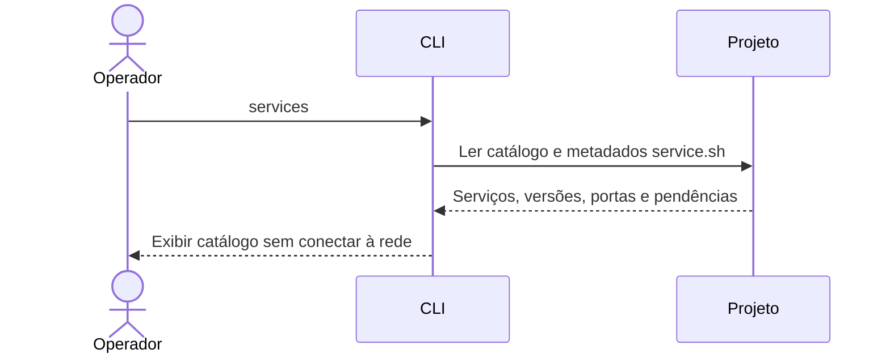
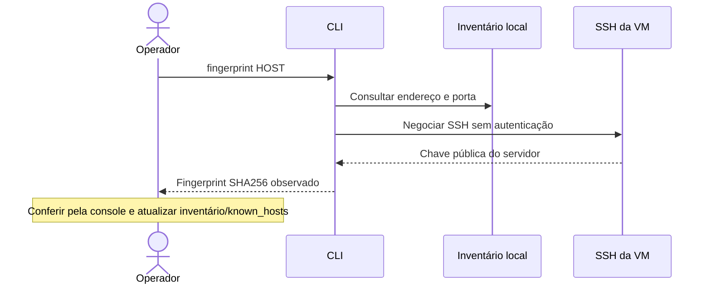
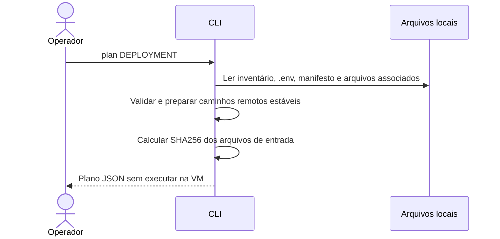
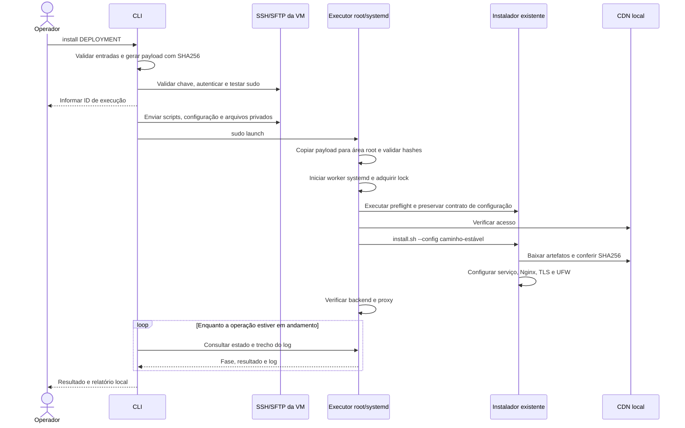
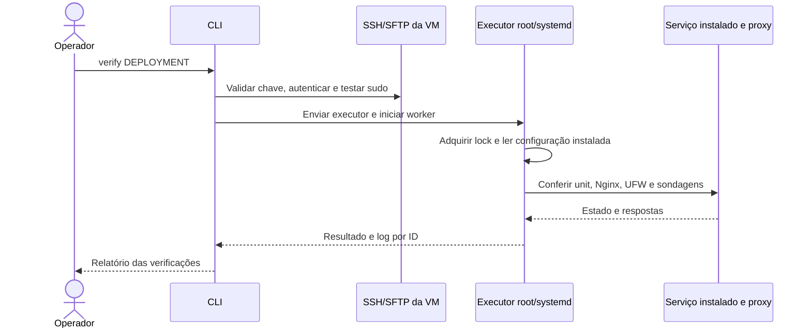
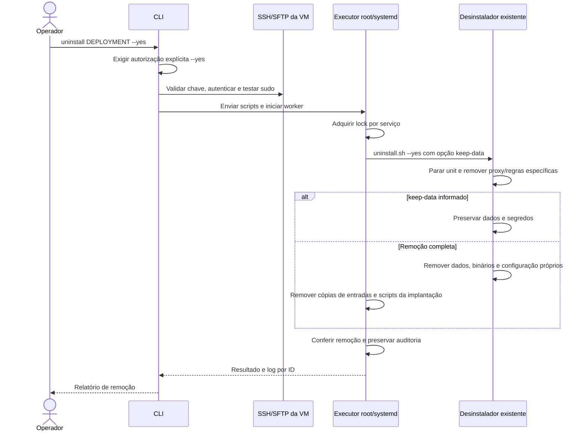
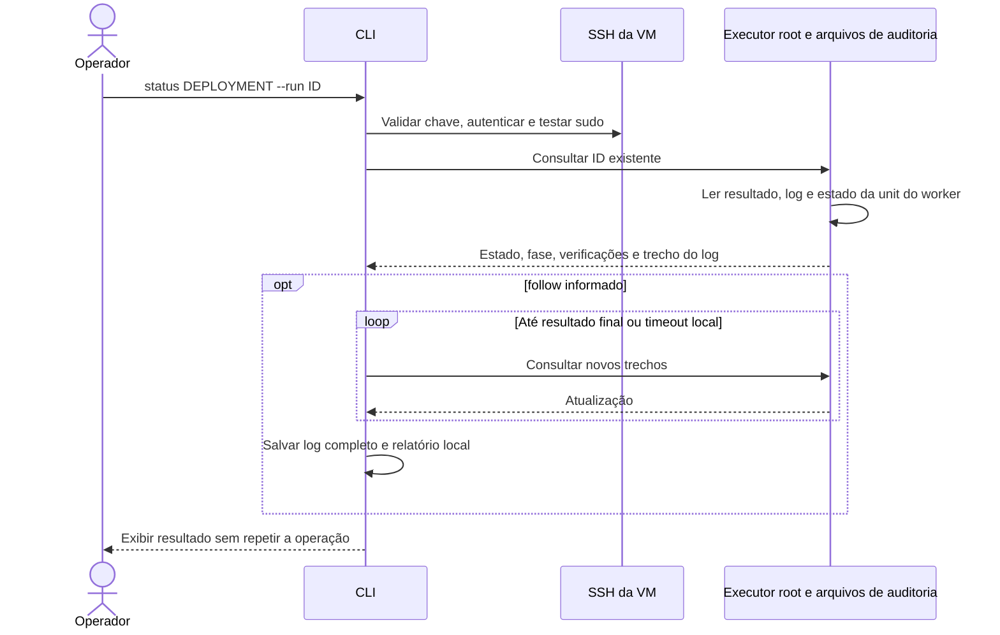

# Instalador remoto — MVP

CLI para selecionar um serviço, conectar a uma VM por SSH, elevar privilégios com `sudo` e executar os instaladores deste projeto. A máquina controladora pode ser **Windows ou Linux**, com Python **3.11 ou superior**; os destinos suportados são **Ubuntu Server 26.04 LTS amd64 com systemd**. Os downloads continuam vindo do CDN local, sem Docker.

## Funcionalidades e comandos

| Comando | Função | Conecta à VM? |
| --- | --- | --- |
| `services` | Lista os dez serviços nativos, versões e serviços pendentes | Não |
| `fingerprint HOST` | Consulta a chave pública SSH para conferência | Sim, sem autenticação |
| `plan DEPLOYMENT` | Valida arquivos locais e mostra destino, parâmetros e SHA256 dos arquivos enviados | Não |
| `install DEPLOYMENT` | Envia scripts/configuração, faz preflight, instala e verifica | Sim, com sudo |
| `verify DEPLOYMENT` | Verifica uma instalação já existente | Sim, com sudo |
| `uninstall DEPLOYMENT --yes` | Executa remoção completa ou preserva dados com `--keep-data` | Sim, com sudo |
| `status DEPLOYMENT --run ID` | Consulta uma execução anterior; `--follow` acompanha até terminar | Sim, com sudo |

Serviços disponíveis: Grafana, Jenkins, Keycloak, Nexus, OpenSearch, PostgreSQL, Prometheus, Redis, SonarQube e Technitium. Harbor e Argo CD permanecem pendentes; Kubernetes continua reservado para reutilização de outro projeto. Selecionar um desses serviços pendentes gera erro antes da conexão.

O MVP opera **um serviço em uma VM por comando**. Ele não provisiona VMs, cria registros DNS automaticamente, configura integrações entre produtos ou faz upgrades. PostgreSQL/bancos/usuários de Keycloak e SonarQube devem estar preparados conforme seus READMEs. A interface web e destinos Windows são evoluções futuras.

## 1. Preparar a máquina controladora

Execute na raiz deste repositório. No Windows/PowerShell:

```powershell
python -m venv installer/.venv
installer/.venv/Scripts/python.exe -m pip install -r installer/requirements.txt
Copy-Item installer/inventory.example.json installer/inventory.json
```

No Linux:

```bash
python3 -m venv installer/.venv
installer/.venv/bin/python -m pip install -r installer/requirements.txt
cp installer/inventory.example.json installer/inventory.json
chmod 600 installer/inventory.json
```

Nos exemplos seguintes, `python` representa o Python desse ambiente virtual. Ative o ambiente ou substitua `python` por `installer/.venv/Scripts/python.exe` ou `installer/.venv/bin/python`. O único pacote diretamente requerido pelo controlador é [Paramiko 5.0.0](https://pypi.org/project/paramiko/5.0.0/); suas dependências são instaladas pelo pip. A VM não recebe Paramiko: o executor remoto usa a biblioteca padrão do Python.

Para um controlador sem internet, prepare os wheels em uma máquina com o mesmo sistema/arquitetura/Python usando `python -m pip download -r installer/requirements.txt --dest installer/private/wheels`. Depois instale com `python -m pip install --no-index --find-links installer/private/wheels -r installer/requirements.txt`.

Na VM, antes da primeira operação, são necessários SSH/SFTP acessível, usuário autorizado a usar sudo/root, Python 3, Bash, curl, util-linux e systemd. Em uma VM Ubuntu recém-criada, prepare os pré-requisitos pela console ou SSH:

```bash
sudo apt-get update
sudo apt-get install -y openssh-server python3 curl ca-certificates util-linux
sudo systemctl enable --now ssh
```

As demais dependências dos serviços são instaladas pelos scripts existentes a partir dos bundles oficiais Ubuntu no CDN. Confira [preparação do CDN](../docs/cdn.md) e [requisitos dos instaladores](../docs/linux.md).

## 2. Configurar o inventário

Edite `installer/inventory.json`. O exemplo contém o host `codex` e os deployments `grafana-codex` e `dns-codex`, apontando para a VM de homologação `192.168.0.250`. Cada deployment associa **serviço + host + configuração**. Para produção, ajuste IPs, usuários, redes e domínio.

```json
{
  "schema": 1,
  "hosts": {
    "grafana-vm": {
      "address": "192.168.0.203",
      "port": 22,
      "user": "trendsoftware",
      "identity_file": "private/id_ed25519",
      "known_hosts": "private/known_hosts"
    }
  },
  "deployments": {
    "grafana-lan": {
      "host": "grafana-vm",
      "service": "grafana",
      "config": "../grafana/linux/.env.example",
      "manifest": "../artifacts/cdn/ubuntu26-amd64/manifest.json",
      "overrides": {
        "DOMAIN": "grafana.trendsoftware.brasil",
        "ACCESS_CIDRS": "192.168.0.0/24",
        "SSH_CIDRS": "192.168.0.0/24"
      },
      "files": {}
    }
  }
}
```

Todos os caminhos locais são relativos **ao arquivo de inventário**, ou podem ser absolutos. O campo `config` pode apontar para uma cópia privada do `.env`; `overrides` substitui chaves já presentes nele. `SSH_PORT` precisa coincidir com a porta do host. Os valores mantêm o contrato `KEY=value` literal dos scripts, sem expansão de shell.

`manifest` deve ser uma cópia confiável do manifesto produzido na preparação do CDN. Ele é enviado por SFTP; o instalador não baixa um novo manifesto do servidor HTTP. O preflight consulta o CDN, e os scripts verificam o SHA256 dos artefatos antes de utilizá-los.

Use `files` para indicar arquivos **locais** que precisam chegar à VM:

```json
{
  "DB_PASSWORD_FILE": "private/keycloak-db-password.txt",
  "DB_CA_PATH": "private/postgresql-ca.crt",
  "TLS_CERT_PATH": "private/keycloak.crt",
  "TLS_KEY_PATH": "private/keycloak.key"
}
```

As chaves aceitas são `TLS_CERT_PATH`, `TLS_KEY_PATH`, `DB_PASSWORD_FILE`, `DB_CA_PATH` e `DNS_RECORDS_PATH`, quando presentes no `.env` do serviço. Um caminho preenchido no `.env` exige sua entrada correspondente em `files`. Os arquivos são enviados para caminhos estáveis em `/opt/sdlc-remote/<serviço>/inputs/`, e a configuração enviada recebe esses caminhos. Isso permite reinstalar com o mesmo inventário sem mudar `install.env` a cada execução.

Para Technitium, o exemplo já mapeia `DNS_RECORDS_PATH` para [records.example.json](../technitium/config/records.example.json). Esse JSON contém IPs sugeridos: ajuste-o para sua rede antes de instalar. A importação inicial segue o contrato do serviço; reexecutar `install` não reaplica registros DNS.

## 3. Autenticação e elevação

Por padrão, a CLI tenta a chave definida em `identity_file`, chaves locais ou agente SSH compatível. Ela valida a chave do servidor usando `known_hosts`, o arquivo `~/.ssh/known_hosts` ou um fingerprint SHA256 fixado em `host_key_sha256`. Não aceita automaticamente um servidor desconhecido. A política utiliza os mecanismos de verificação da [API oficial do Paramiko](https://docs.paramiko.org/en/stable/api/client.html).

Quando `host_key_sha256` está preenchido, esse fingerprint é a fonte de confiança e é conferido antes da autenticação. Sem ele, a fonte de confiança é `known_hosts`.

Para consultar a chave de um host novo:

```bash
python installer/cli.py fingerprint grafana-vm
```

Compare o resultado com a chave obtida pela console da VM, por exemplo `sudo ssh-keygen -lf /etc/ssh/ssh_host_ed25519_key.pub -E sha256`. Depois registre o fingerprint em `hosts.<nome>.host_key_sha256` ou entregue um `known_hosts` confiável. O exemplo Codex contém a chave conferida durante a homologação; para outro servidor, use a chave correspondente. `fingerprint` apenas observa a chave: não altera o inventário nem estabelece confiança por si só.

Para SSH/sudo com senha, use prompts sem eco:

```bash
python installer/cli.py install grafana-codex --ask-pass --ask-sudo-pass
```

Sem senha sudo fornecida, a CLI utiliza `sudo -n` e falha se a elevação exigir interação. Não altera `sudoers`. Em automação, os segredos podem ser injetados por `SDLC_SSH_PASSWORD`, `SDLC_SUDO_PASSWORD` e `SDLC_KEY_PASSPHRASE`; essas variáveis são removidas do ambiente do processo ao serem consumidas e não são repassadas ao executor. As senhas não aparecem nos argumentos dos comandos nem no inventário.

## 4. Operação por comando

Os exemplos usam o inventário padrão `installer/inventory.json`. Para outro arquivo, acrescente `--inventory /caminho/inventory.json` ao comando. Consulte `python installer/cli.py COMANDO --help` para os argumentos.

### `services`: consultar o catálogo

```bash
python installer/cli.py services
```



### `fingerprint`: consultar a chave SSH

```bash
python installer/cli.py fingerprint codex
```



### `plan`: revisar os parâmetros

```bash
python installer/cli.py plan grafana-codex
python installer/cli.py plan grafana-codex --action uninstall
```

Para instalação, valida inventário, arquivos, valores literais, plataforma/artefatos presentes no manifesto e JSON DNS quando aplicável. Mostra configuração final e hashes, sem imprimir conteúdo dos arquivos de segredo. Não testa conectividade ou disponibilidade real de portas; essas verificações acontecem na VM.



### `install`: instalar e verificar

```bash
python installer/cli.py install grafana-codex
```

O preflight usa as validações dos próprios scripts: Ubuntu/arquitetura/systemd, domínio, CIDRs, preservação do acesso SSH, portas, propriedade dos diretórios e recursos exigidos pelo serviço. Também verifica o acesso ao bundle base no CDN e registra memória/espaço disponível. Após a instalação, verifica a saúde do serviço. Repetir o comando com a mesma configuração segue a retomada permitida pelo instalador; configuração, arquivos associados ou versão diferentes exigem manutenção explícita.



### `verify`: verificar uma instalação

```bash
python installer/cli.py verify grafana-codex
```

Verifica marcador de instalação, unit ativa, Nginx válido/ativo e UFW ativo. Sonda health HTTP dos serviços, `SELECT 1` no PostgreSQL, `PING` autenticado no Redis e DNS UDP/TCP mais painel no Technitium. Para HTTP, verifica certificado/hostname do proxy; respostas 401/403 são registradas como restrição de autenticação/ACL, junto da sondagem independente do backend. PostgreSQL/Redis têm TLS do proxy sondado quando a própria VM pertence a `ACCESS_CIDRS`; caso contrário, o relatório explicita que verificou apenas o listener público.



`verify` não reinstala nem redefine configurações. Os relatórios são uma verificação operacional a partir da própria VM; não comprovam alcance do firewall de todos os clientes nem substituem testes de carga, backup ou integrações. Verificar um serviço ausente/incompleto retorna falha. Não precisa dos arquivos locais de configuração/manifesto/segredos de instalação.

### `uninstall`: remover o serviço

```bash
# Preservar dados e segredos para uma reinstalação:
python installer/cli.py uninstall grafana-codex --yes --keep-data
# Remover completamente o serviço e seus dados:
python installer/cli.py uninstall grafana-codex --yes
```



Sem `--yes`, a CLI encerra antes de conectar. A remoção completa também apaga os arquivos de entrada privados da implantação remota. Relatórios permanecem em `/opt/sdlc-remote/<serviço>/jobs/`; pacotes compartilhados, Nginx, UFW e regras SSH seguem o contrato dos desinstaladores e permanecem.

### `status`: consultar ou reconectar

```bash
python installer/cli.py status grafana-codex --run ID
python installer/cli.py status grafana-codex --run ID --follow
```



## 5. Logs, falhas e retomada

O ID é exibido antes de iniciar o trabalho remoto. A unit transitória `sdlc-remote-<serviço>-<ID>` roda como root, com limite de duas horas. Fechar a CLI, perder a conexão SSH ou atingir `--timeout` do acompanhamento **não cancela** um worker já iniciado. Reconecte com `status --follow`; se a falha ocorreu antes do lançamento, o ID pode não existir na VM.

Estados: `queued`, `running`, `succeeded`, `failed` e `interrupted`. O último indica worker inativo sem resultado final, por exemplo após reboot ou limite de execução; examine o estado antes de reexecutar. Não existe rollback automático nem reinício automático do worker após reboot. Falhas preservam o estado parcial para diagnóstico.

Há lock por serviço no executor e o lock global dos instaladores para alterações compartilhadas. Operações conflitantes falham com resultado explícito; não entram em uma fila automática. Uma instalação que concluiu seu script e falhou na verificação pode estar instalada: use `verify` para investigar.

| Local | Conteúdo |
| --- | --- |
| `installer/.state/runs/<ID>/operation.log` | Log recuperado pelo acompanhamento |
| `installer/.state/runs/<ID>/result.json` | Resultado, fases, horários, SHA256 do payload e verificações |
| `/opt/sdlc-remote/<serviço>/inputs/` | Configuração, manifesto e arquivos associados, privados de root |
| `/opt/sdlc-remote/<serviço>/project/` | Scripts da implantação em caminhos estáveis |
| `/opt/sdlc-remote/<serviço>/jobs/<ID>/` | Executor e auditoria da execução |
| `/opt/sdlc/<serviço>/` | Configuração/segredos do serviço, geridos pelo instalador original |

O payload contém somente rotinas Linux comuns e a pasta Linux do serviço selecionado; não inclui `.git`, binários grandes, `.env` privados do projeto ou pastas de validação. As entradas declaradas são enviadas separadamente. O stage SFTP é removido ao terminar o lançamento; cópias de código/entradas por job são removidas ao terminar o worker. Área root usa 0700/0600. Senhas conhecidas são ocultadas nos logs; credenciais geradas continuam somente nos arquivos protegidos do serviço.

Use `--state-dir /pasta/privada` para mudar a localização dos relatórios. No Windows, as permissões efetivas dependem das ACLs NTFS: mantenha inventário, chaves, arquivos de segredo e relatórios em uma pasta restrita ao operador. Inventário privado, ambiente virtual, estado e `installer/private/` estão no `.gitignore`.

Saídas: `0` para sucesso, plano, consulta ou status ainda em andamento; `1` para erro/falha; `130` para interrupção local com Ctrl+C. `status --follow` retorna `1` para resultado final `failed/interrupted`. Um `status` simples retorna um trecho do log; `--follow` recupera o log completo desde o início.

## Validação e evolução

Veja [a validação do MVP](validation.md) para testes executados e limites da homologação. A separação entre `cli.py` e `remote.py` permite adicionar um executor específico para destinos Windows no futuro. Uma interface web poderá invocar o mesmo fluxo; gestão de usuários, múltiplas operações, upgrades e provisionamento de VMs ficam para outras etapas.
