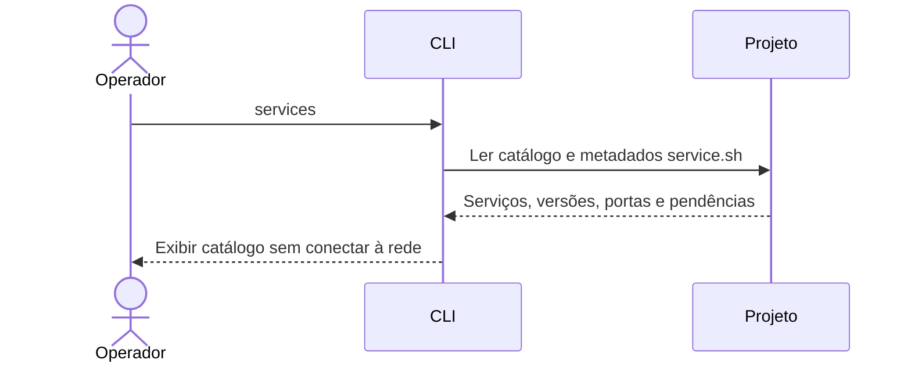
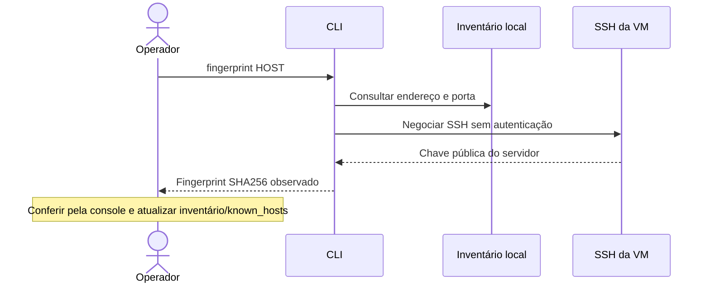
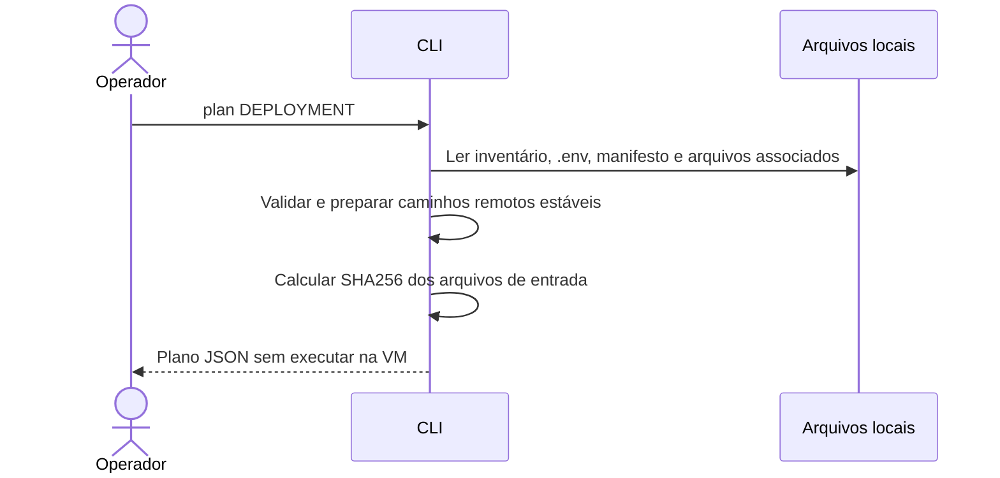
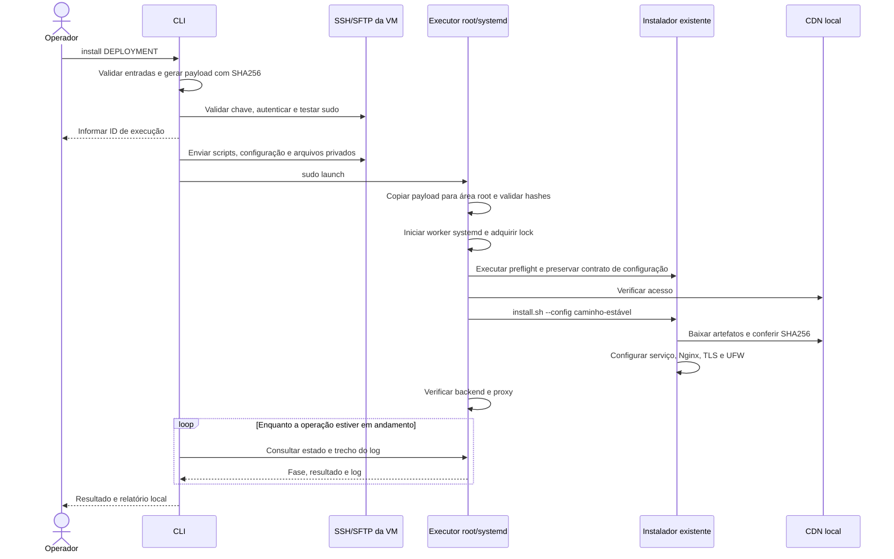
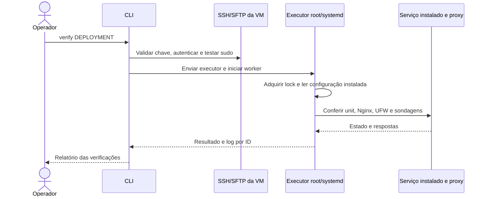
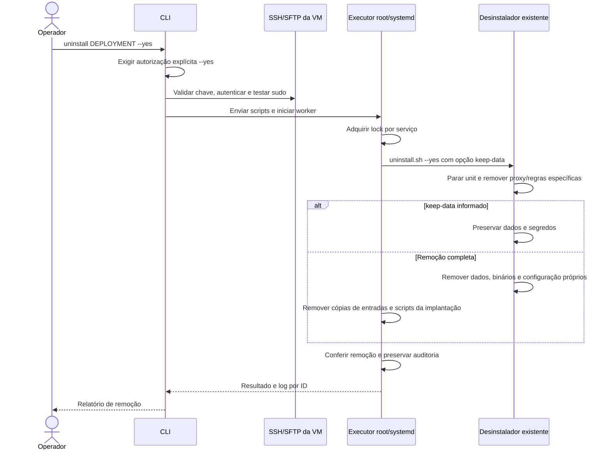
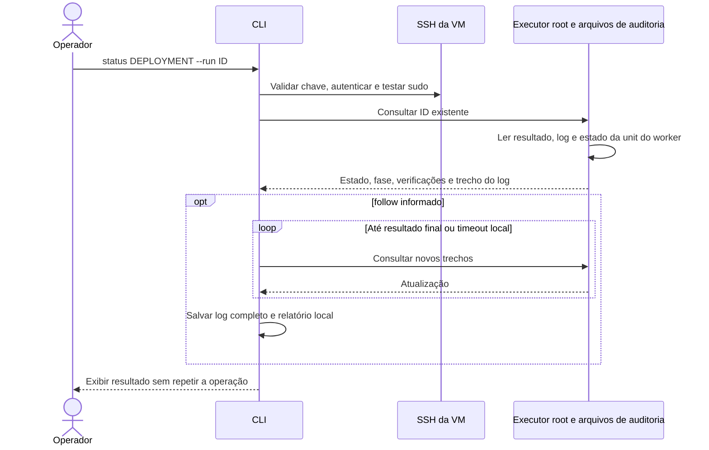
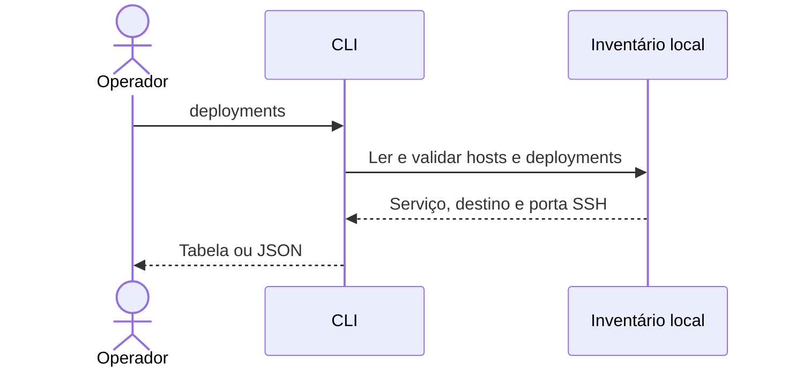
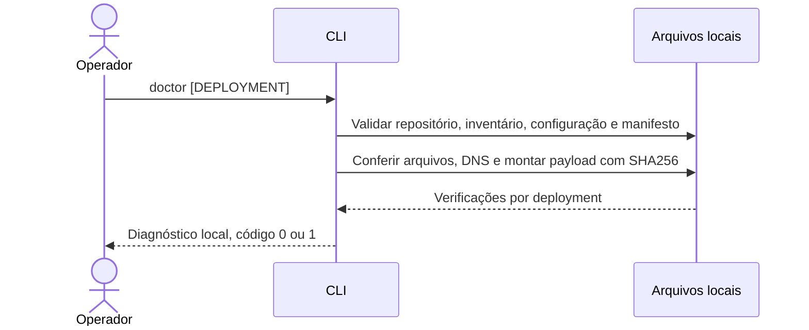
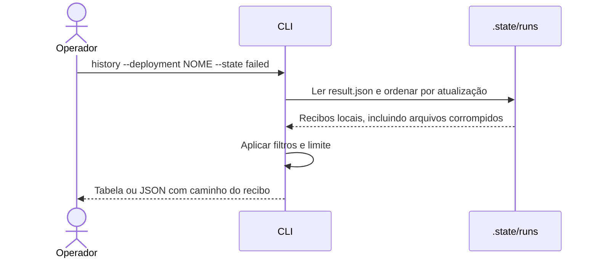

# Instalador remoto SDLC com uv

CLI para selecionar um serviço, conectar a uma VM por SSH, elevar privilégios com `sudo` e executar os instaladores deste projeto. A máquina controladora pode ser **Windows ou Linux**, com Python **3.11 ou superior**; os destinos suportados são **Ubuntu Server 26.04 LTS amd64 com systemd**. Os downloads continuam vindo do CDN local, sem Docker.

## Funcionalidades e comandos

| Comando | Função | Conecta à VM? |
| --- | --- | --- |
| `services` | Lista os dez serviços nativos, versões e serviços pendentes | Não |
| `deployments` | Lista destinos do inventário | Não |
| `doctor [DEPLOYMENT]` | Diagnostica entradas locais, manifesto, payload e confiança SSH | Não |
| `history` | Lista recibos locais com filtros | Não |
| `fingerprint HOST` | Consulta a chave pública SSH para conferência | Sim, sem autenticação |
| `plan DEPLOYMENT` | Valida arquivos locais e mostra destino, parâmetros e SHA256 dos arquivos enviados | Não |
| `install DEPLOYMENT` | Envia scripts/configuração, faz preflight, instala e verifica | Sim, com sudo |
| `verify DEPLOYMENT` | Verifica uma instalação já existente | Sim, com sudo |
| `uninstall DEPLOYMENT --yes` | Executa remoção completa ou preserva dados com `--keep-data` | Sim, com sudo |
| `status DEPLOYMENT --run ID` | Consulta uma execução anterior; `--follow` acompanha até terminar | Sim, com sudo |

Serviços disponíveis: Grafana, Jenkins, Keycloak, Nexus, OpenSearch, PostgreSQL, Prometheus, Redis, SonarQube e Technitium. Harbor e Argo CD permanecem pendentes; Kubernetes continua reservado para reutilização de outro projeto. Selecionar um desses serviços pendentes gera erro antes da conexão.

O MVP opera **um serviço em uma VM por comando**. Ele não provisiona VMs, cria registros DNS automaticamente, configura integrações entre produtos ou faz upgrades. PostgreSQL/bancos/usuários de Keycloak e SonarQube devem estar preparados conforme seus READMEs. A interface web e destinos Windows são evoluções futuras.

## 1. Preparar a máquina controladora

Execute na raiz deste repositório. O projeto usa **uv 0.13.x**, Python 3.14 como versão de desenvolvimento e suporta Python 3.11 ou superior no controlador. O `uv` cria o ambiente, instala o pacote e resolve o comando `sdlc-installer`.

Windows/PowerShell, instalação oficial do uv e preparação:

```powershell
powershell -ExecutionPolicy ByPass -c "irm https://astral.sh/uv/0.13.0/install.ps1 | iex"
# Abra um novo terminal para atualizar o PATH.
uv sync --project installer --locked
Copy-Item installer/inventory.example.json installer/inventory.json
uv run --project installer --locked sdlc-installer --version
uv run --project installer --locked sdlc-installer services
```

Linux:

```bash
curl -LsSf https://astral.sh/uv/0.13.0/install.sh | sh
export PATH="$HOME/.local/bin:$PATH"
uv sync --project installer --locked
cp installer/inventory.example.json installer/inventory.json
chmod 600 installer/inventory.json
uv run --project installer --locked sdlc-installer services
```

As dependências de execução **Paramiko e Rich**, os requisitos do build e as ferramentas de desenvolvimento **pytest e Ruff** ficam no [pyproject.toml](pyproject.toml). O [uv.lock](uv.lock) fixa as versões e hashes e deve ser versionado. `--locked` recusa mudanças que exigiriam atualizar o lock; use `uv add --project installer PACOTE` ou `uv lock --project installer --upgrade-package PACOTE` quando desejar atualizar uma dependência. Para um ambiente somente de execução, use `uv sync --project installer --locked --no-dev`.

O controlador usa Rich para tabelas, resultados e progresso, enquanto o executor enviado à VM usa somente a biblioteca padrão do Python. O arquivo [cli.py](cli.py) permanece como entrada compatível para ambientes já sincronizados; o comando oficial é `sdlc-installer`.

Na VM, antes da primeira operação, são necessários SSH/SFTP acessível, usuário autorizado a usar sudo/root, Python 3, Bash, curl, util-linux e systemd. Em uma VM Ubuntu recém-criada, prepare os pré-requisitos pela console ou SSH:

```bash
sudo apt-get update
sudo apt-get install -y openssh-server python3 curl ca-certificates util-linux
sudo systemctl enable --now ssh
```

As demais dependências dos serviços são instaladas pelos scripts existentes a partir dos bundles oficiais Ubuntu no CDN. Confira [preparação do CDN](../docs/cdn.md) e [requisitos dos instaladores](../docs/linux.md).

## 2. Configurar o inventário

Edite `installer/inventory.json`. O exemplo contém o host `codex` e os deployments `grafana-codex` e `dns-codex`, apontando para a VM de homologação `192.168.0.250`. Cada deployment associa **serviço + host + configuração**. Para produção, ajuste IPs, usuários, redes e domínio.

```json
{
  "schema": 1,
  "hosts": {
    "grafana-vm": {
      "address": "192.168.0.203",
      "port": 22,
      "user": "trendsoftware",
      "identity_file": "private/id_ed25519",
      "known_hosts": "private/known_hosts"
    }
  },
  "deployments": {
    "grafana-lan": {
      "host": "grafana-vm",
      "service": "grafana",
      "config": "../grafana/linux/.env.example",
      "manifest": "../artifacts/cdn/ubuntu26-amd64/manifest.json",
      "overrides": {
        "DOMAIN": "grafana.trendsoftware.brasil",
        "ACCESS_CIDRS": "192.168.0.0/24",
        "SSH_CIDRS": "192.168.0.0/24"
      },
      "files": {}
    }
  }
}
```

Todos os caminhos locais são relativos **ao arquivo de inventário**, ou podem ser absolutos. O campo `config` pode apontar para uma cópia privada do `.env`; `overrides` substitui chaves já presentes nele. `SSH_PORT` precisa coincidir com a porta do host. Os valores mantêm o contrato `KEY=value` literal dos scripts, sem expansão de shell.

`manifest` deve ser uma cópia confiável do manifesto produzido na preparação do CDN. Ele é enviado por SFTP; o instalador não baixa um novo manifesto do servidor HTTP. O preflight consulta o CDN, e os scripts verificam o SHA256 dos artefatos antes de utilizá-los.

Use `files` para indicar arquivos **locais** que precisam chegar à VM:

```json
{
  "DB_PASSWORD_FILE": "private/keycloak-db-password.txt",
  "DB_CA_PATH": "private/postgresql-ca.crt",
  "TLS_CERT_PATH": "private/keycloak.crt",
  "TLS_KEY_PATH": "private/keycloak.key"
}
```

As chaves aceitas são `TLS_CERT_PATH`, `TLS_KEY_PATH`, `DB_PASSWORD_FILE`, `DB_CA_PATH` e `DNS_RECORDS_PATH`, quando presentes no `.env` do serviço. Um caminho preenchido no `.env` exige sua entrada correspondente em `files`. Os arquivos são enviados para caminhos estáveis em `/opt/sdlc-remote/<serviço>/inputs/`, e a configuração enviada recebe esses caminhos. Isso permite reinstalar com o mesmo inventário sem mudar `install.env` a cada execução.

Para Technitium, o exemplo já mapeia `DNS_RECORDS_PATH` para [records.example.json](../technitium/config/records.example.json). Esse JSON contém IPs sugeridos: ajuste-o para sua rede antes de instalar. A importação inicial segue o contrato do serviço; reexecutar `install` não reaplica registros DNS.

## 3. Autenticação e elevação

Por padrão, a CLI tenta a chave definida em `identity_file`, chaves locais ou agente SSH compatível. Ela valida a chave do servidor usando `known_hosts`, o arquivo `~/.ssh/known_hosts` ou um fingerprint SHA256 fixado em `host_key_sha256`. Não aceita automaticamente um servidor desconhecido. A política utiliza os mecanismos de verificação da [API oficial do Paramiko](https://docs.paramiko.org/en/stable/api/client.html).

Quando `host_key_sha256` está preenchido, esse fingerprint é a fonte de confiança e é conferido antes da autenticação. Sem ele, a fonte de confiança é `known_hosts`.

Para consultar a chave de um host novo:

```bash
uv run --project installer --locked sdlc-installer fingerprint grafana-vm
```

Compare o resultado com a chave obtida pela console da VM, por exemplo `sudo ssh-keygen -lf /etc/ssh/ssh_host_ed25519_key.pub -E sha256`. Depois registre o fingerprint em `hosts.<nome>.host_key_sha256` ou entregue um `known_hosts` confiável. O exemplo Codex contém a chave conferida durante a homologação; para outro servidor, use a chave correspondente. `fingerprint` apenas observa a chave: não altera o inventário nem estabelece confiança por si só.

Para SSH/sudo com senha, use prompts sem eco:

```bash
uv run --project installer --locked sdlc-installer install grafana-codex --ask-pass --ask-sudo-pass
```

Sem senha sudo fornecida, a CLI utiliza `sudo -n` e falha se a elevação exigir interação. Não altera `sudoers`. Em automação, os segredos podem ser injetados por `SDLC_SSH_PASSWORD`, `SDLC_SUDO_PASSWORD` e `SDLC_KEY_PASSPHRASE`; essas variáveis são removidas do ambiente do processo ao serem consumidas e não são repassadas ao executor. As senhas não aparecem nos argumentos dos comandos nem no inventário.

## 4. Operação por comando

Os exemplos usam o inventário padrão `installer/inventory.json`. Para outro arquivo, acrescente `--inventory /caminho/inventory.json` ao comando. Consulte `uv run --project installer --locked sdlc-installer COMANDO --help` para os argumentos.

### `services`: consultar o catálogo

```bash
uv run --project installer --locked sdlc-installer services
```



### `fingerprint`: consultar a chave SSH

```bash
uv run --project installer --locked sdlc-installer fingerprint codex
```



### `plan`: revisar os parâmetros

```bash
uv run --project installer --locked sdlc-installer plan grafana-codex
uv run --project installer --locked sdlc-installer plan grafana-codex --action uninstall
```

Para instalação, valida inventário, arquivos, valores literais, plataforma/artefatos presentes no manifesto e JSON DNS quando aplicável. Mostra configuração final e hashes, sem imprimir conteúdo dos arquivos de segredo. Não testa conectividade ou disponibilidade real de portas; essas verificações acontecem na VM.



### `install`: instalar e verificar

```bash
uv run --project installer --locked sdlc-installer install grafana-codex
```

O preflight usa as validações dos próprios scripts: Ubuntu/arquitetura/systemd, domínio, CIDRs, preservação do acesso SSH, portas, propriedade dos diretórios e recursos exigidos pelo serviço. Também verifica o acesso ao bundle base no CDN e registra memória/espaço disponível. Após a instalação, verifica a saúde do serviço. Repetir o comando com a mesma configuração segue a retomada permitida pelo instalador; configuração, arquivos associados ou versão diferentes exigem manutenção explícita.



### `verify`: verificar uma instalação

```bash
uv run --project installer --locked sdlc-installer verify grafana-codex
```

Verifica marcador de instalação, unit ativa, Nginx válido/ativo e UFW ativo. Sonda health HTTP dos serviços, `SELECT 1` no PostgreSQL, `PING` autenticado no Redis e DNS UDP/TCP mais painel no Technitium. Para HTTP, verifica certificado/hostname do proxy; respostas 401/403 são registradas como restrição de autenticação/ACL, junto da sondagem independente do backend. PostgreSQL/Redis têm TLS do proxy sondado quando a própria VM pertence a `ACCESS_CIDRS`; caso contrário, o relatório explicita que verificou apenas o listener público.



`verify` não reinstala nem redefine configurações. Os relatórios são uma verificação operacional a partir da própria VM; não comprovam alcance do firewall de todos os clientes nem substituem testes de carga, backup ou integrações. Verificar um serviço ausente/incompleto retorna falha. Não precisa dos arquivos locais de configuração/manifesto/segredos de instalação.

### `uninstall`: remover o serviço

```bash
# Preservar dados e segredos para uma reinstalação:
uv run --project installer --locked sdlc-installer uninstall grafana-codex --yes --keep-data
# Remover completamente o serviço e seus dados:
uv run --project installer --locked sdlc-installer uninstall grafana-codex --yes
```



Sem `--yes`, a CLI encerra antes de conectar. A remoção completa também apaga os arquivos de entrada privados da implantação remota. Relatórios permanecem em `/opt/sdlc-remote/<serviço>/jobs/`; pacotes compartilhados, Nginx, UFW e regras SSH seguem o contrato dos desinstaladores e permanecem.

### `status`: consultar ou reconectar

```bash
uv run --project installer --locked sdlc-installer status grafana-codex --run ID
uv run --project installer --locked sdlc-installer status grafana-codex --run ID --follow
```



## 5. Logs, falhas e retomada

O ID é exibido antes de iniciar o trabalho remoto. A unit transitória `sdlc-remote-<serviço>-<ID>` roda como root, com limite de duas horas. Fechar a CLI, perder a conexão SSH ou atingir `--timeout` do acompanhamento **não cancela** um worker já iniciado. Reconecte com `status --follow`; se a falha ocorreu antes do lançamento, o ID pode não existir na VM.

Estados: `queued`, `running`, `succeeded`, `failed` e `interrupted`. O último indica worker inativo sem resultado final, por exemplo após reboot ou limite de execução; examine o estado antes de reexecutar. Não existe rollback automático nem reinício automático do worker após reboot. Falhas preservam o estado parcial para diagnóstico.

Há lock por serviço no executor e o lock global dos instaladores para alterações compartilhadas. Operações conflitantes falham com resultado explícito; não entram em uma fila automática. Uma instalação que concluiu seu script e falhou na verificação pode estar instalada: use `verify` para investigar.

| Local | Conteúdo |
| --- | --- |
| `installer/.state/logs/installer.jsonl` | Eventos estruturados do controlador, com rotação |
| `installer/.state/runs/<ID>/operation.log` | Log recuperado pelo acompanhamento |
| `installer/.state/runs/<ID>/result.json` | Resultado, fases, horários, SHA256 do payload e verificações |
| `/opt/sdlc-remote/<serviço>/inputs/` | Configuração, manifesto e arquivos associados, privados de root |
| `/opt/sdlc-remote/<serviço>/project/` | Scripts da implantação em caminhos estáveis |
| `/opt/sdlc-remote/<serviço>/jobs/<ID>/` | Executor e auditoria da execução |
| `/opt/sdlc/<serviço>/` | Configuração/segredos do serviço, geridos pelo instalador original |

O payload contém somente rotinas Linux comuns e a pasta Linux do serviço selecionado; não inclui `.git`, binários grandes, `.env` privados do projeto ou pastas de validação. As entradas declaradas são enviadas separadamente. O stage SFTP é removido ao terminar o lançamento; cópias de código/entradas por job são removidas ao terminar o worker. Área root usa 0700/0600. Senhas conhecidas são ocultadas nos logs; credenciais geradas continuam somente nos arquivos protegidos do serviço.

Use `--state-dir /pasta/privada` para mudar a localização dos relatórios. No Windows, as permissões efetivas dependem das ACLs NTFS: mantenha inventário, chaves, arquivos de segredo e relatórios em uma pasta restrita ao operador. Inventário privado, ambiente virtual, estado e `installer/private/` estão no `.gitignore`.

Saídas: `0` para sucesso, plano, consulta ou status ainda em andamento; `1` para erro/falha; `2` para argumentos inválidos; `130` para interrupção local com Ctrl+C. `status --follow` retorna `1` para resultado final `failed/interrupted`. Um `status` simples retorna um trecho do log; `--follow` recupera o log completo desde o início.

## 6. CLI para diagnóstico, automação e retomada

As opções globais podem aparecer antes ou depois do comando. A descoberta do projeto segue esta ordem: `--repo`, variável `SDLC_REPO`, diretório atual e seus pais, localização do pacote em modo de desenvolvimento. O inventário e o estado padrão ficam em `<repo>/installer/`. Caminhos informados por `--inventory`, `--state-dir` e `--log-file` são relativos ao diretório atual; os caminhos internos do inventário continuam relativos ao próprio JSON.

```bash
uv run --project installer --locked sdlc-installer --help
uv run --project installer --locked sdlc-installer install --help
uv run --project installer --locked sdlc-installer deployments
uv run --project installer --locked sdlc-installer doctor grafana-codex
uv run --project installer --locked sdlc-installer doctor
uv run --project installer --locked sdlc-installer history --deployment grafana-codex --limit 10
uv run --project installer --locked sdlc-installer history --state failed
```

`deployments` lista serviço, host, usuário e porta SSH, sem imprimir os arquivos de segredo ou os overrides. `doctor` valida somente o lado local, incluindo a montagem real do payload; conectividade, conteúdo da chave SSH presente em `known_hosts`, sudo, CDN e saúde da VM são verificados nas operações remotas. Um arquivo `known_hosts` existente ainda pode não conter a chave do destino. `history` mostra os recibos recuperados por este controlador; ele não consulta a VM e pode mostrar um estado antigo até executar `status`.







Para automação, `--json` produz **um documento JSON em stdout por comando**; os eventos ficam em stderr, também em JSON. Argumentos inválidos e falhas incluem `error` e `exit_code`. Use `--quiet` para ocultar os eventos e o progresso, mantendo o resultado. `--no-color` e a variável `NO_COLOR` desabilitam cores. No PowerShell, prefira `| Set-Content -Encoding utf8 resultado.json` ao salvar JSON para garantir UTF-8.

```bash
uv run --project installer --locked sdlc-installer plan grafana-codex --json > plano.json
uv run --project installer --locked sdlc-installer install grafana-codex --no-follow --json
uv run --project installer --locked sdlc-installer status grafana-codex --run ID --follow --json --quiet
```

`--no-follow` retorna após confirmar o lançamento do job e salva seu recibo. Código `0` significa que o lançamento foi aceito; consulte `status --follow` para saber se a instalação terminou com sucesso. O resultado inclui `run` e um comando de retomada; mantenha as opções de inventário/repositório que utilizou e a autenticação necessária ao retomá-lo. Para ajustar o acompanhamento, use `--poll-interval 2 --timeout 3600 --connect-timeout 15 --command-timeout 60`, em segundos. Todos exigem números positivos e finitos. Não há repetição automática de instalação/remoção após uma falha de conexão.

## 7. Logging customizável

O logging tem dois canais independentes: **eventos do controlador**, configuráveis e rotativos, e **auditoria de cada execução**, em `runs/<ID>/operation.log` e `result.json`. Alterar a rotação não apaga a auditoria por execução. O `operation.log` local é texto recuperado da VM, com redação de segredos; a VM mantém sua própria auditoria protegida. `--no-log-file` desabilita apenas o arquivo de eventos.

Copie [logging.example.toml](config/logging.example.toml) para um TOML privado, ajuste e carregue:

```bash
uv run --project installer --locked sdlc-installer services --log-config installer/config/logging.example.toml
uv run --project installer --locked sdlc-installer verify grafana-codex -v --log-format text
uv run --project installer --locked sdlc-installer verify grafana-codex --remote-log-level DEBUG
uv run --project installer --locked sdlc-installer services --log-file installer/.state/logs/operacao.jsonl --log-level DEBUG
```

| Configuração TOML | Personalização |
| --- | --- |
| `console_enabled`, `file_enabled` | Habilitar cada destino independentemente |
| `console_level`, `file_level` | DEBUG, INFO, WARNING, ERROR ou CRITICAL por destino |
| `console_format`, `file_format` | Console Rich/texto/JSON; arquivo texto/JSON Lines |
| `console_color` | `auto`, `always`, `never` |
| `file_path` | Caminho relativo ao TOML, ou absoluto |
| `rotation` | `size`, `time`, `none` |
| `max_bytes`, `backup_count` | Limite por tamanho e quantidade de arquivos anteriores; padrão 10 MiB/5 |
| `when`, `interval`, `utc` | Rotação temporal e timezone; `when`: S, M, H, D, midnight, W0…W6 |
| `timestamp_format`, `text_format` | Formato do horário e template do texto |
| `include_context` | Incluir comando, deployment, serviço, host, execução, fase e duração quando disponíveis |
| `remote_level` | Nível das linhas recuperadas da VM, permitindo reduzir o ruído no console |
| `logger_levels` | Nível por logger, por exemplo `{ paramiko = "WARNING" }` |
| `redact_values`, `redact_env`, `redact_patterns` | Valores literais, variáveis de ambiente e regex adicionais para ocultação |

O template de texto aceita `{timestamp}`, `{level}`, `{logger}`, `{event}`, `{message}`, `{command}`, `{deployment}`, `{service}`, `{host}`, `{run}`, `{phase}` e `{duration_ms}`; campos ausentes aparecem como `-`. Modificadores de alinhamento, como `{level:<8}`, são aceitos. Chaves, tipos, níveis, templates e expressões regulares inválidas são recusados antes de conectar.

A precedência é **padrões → TOML → variáveis de ambiente de logging → opções da CLI**. `SDLC_LOG_CONFIG` seleciona o TOML quando `--log-config` não é informado; `SDLC_LOG_LEVEL` define níveis quando `--log-level` não é informado. `-v` eleva o console para DEBUG; `-vv` também ativa DEBUG do Paramiko. `--quiet`, `--no-console-log`, `--no-log-file` e `--json` aplicam suas escolhas por último. O comando `--help` e `--version` não criam logs.

Senha SSH, senha sudo e passphrase são cadastradas para redação antes da conexão. Arquivos de senha enviados também entram na proteção local; o executor continua ocultando segredos gerados no destino. Mensagens, contexto, stack traces em DEBUG, respostas JSON e logs por execução passam pela proteção. Valores usuais de `password`, `token`, `secret`, cabeçalhos Basic/Bearer e credenciais em URLs também são ocultados; padrões adicionais não removem essa proteção. Linhas divididas entre consultas são reunidas antes de gravar o log local. Sequências de controle de terminal recebidas da VM são removidas.

Exemplo de evento JSON Lines:

```json
{"timestamp":"2026-10-12T12:00:00+0000","level":"INFO","logger":"sdlc_installer","event":"run_state","message":"Estado: running; fase: install.","command":"install","deployment":"grafana-codex","service":"grafana","host":"192.168.0.250","run":"0123456789abcdef01234567","phase":"install"}
```

## 8. Build e distribuição

```text
installer/
├── pyproject.toml             dependências, entrypoint e backend uv_build
├── uv.lock                    versões e hashes resolvidos
├── .python-version            Python usado no desenvolvimento
├── src/sdlc_installer/
│   ├── cli.py                 comandos e orquestração
│   ├── core.py                inventário, validação e payload
│   ├── transport.py           SSH/SFTP e sudo
│   ├── operations.py          acompanhamento, recibos e histórico
│   ├── logging_config.py      configuração, redação e rotação
│   ├── presentation.py        tabelas, progresso e JSON
│   └── resources/             catálogo e executor Linux autônomo
├── config/logging.example.toml
├── scripts/check-dist.py      verificação dos artefatos gerados
└── tests/                     testes da CLI e do logging
```

Na raiz do repositório:

```bash
uv lock --project installer --check
uv run --project installer --locked pytest -q
uv run --project installer --locked ruff check installer/src installer/tests installer/scripts installer/cli.py
uv run --project installer --locked ruff format --check installer/src installer/tests installer/scripts installer/cli.py
uv build --project installer
uv run --project installer --locked python installer/scripts/check-dist.py
```

O build gera `installer/dist/sdlc_installer-0.2.0.tar.gz` e `installer/dist/sdlc_installer-0.2.0-py3-none-any.whl`; o wheel é construído a partir do sdist. Ambos incluem o pacote e seus recursos públicos, sem inventário privado, estado, segredos ou artefatos do CDN. O executor empacotado é o mesmo arquivo autônomo enviado por SFTP. O verificador confere conteúdo, catálogo, dependências e entrypoint. A pasta `dist/` é ignorada pelo Git.

Para instalar o wheel como ferramenta:

```bash
uv tool install installer/dist/sdlc_installer-0.2.0-py3-none-any.whl
sdlc-installer --version
sdlc-installer --repo /caminho/sdlc-infrastructure --inventory /caminho/inventory.json services
```

No Windows, os caminhos podem ser `C:/infra/sdlc-infrastructure` e `C:/infra/inventory.json`. O pacote **precisa de uma cópia do projeto de infraestrutura** para acessar os instaladores e modelos de configuração; informe `--repo` ou `SDLC_REPO` ao usá-lo fora do repositório. Os binários dos serviços continuam sendo baixados pela VM do CDN configurado nos `.env`.

Para preparar um controlador sem internet, gere um wheelhouse numa máquina com o mesmo SO, arquitetura e versão do Python do controlador. O requirements abaixo é apenas uma exportação para transporte, gerada do lock, e não deve ser mantido manualmente:

```bash
uv build --project installer
mkdir -p installer/private/wheels
uv export --project installer --locked --no-dev --no-emit-project --format requirements-txt --output-file installer/private/requirements.lock.txt
uv run --project installer --locked --with pip python -m pip download --only-binary=:all: --require-hashes -r installer/private/requirements.lock.txt --dest installer/private/wheels
cp installer/dist/*.whl installer/private/wheels/
```

No PowerShell, substitua `mkdir -p` por `New-Item -ItemType Directory -Force installer/private/wheels` e `cp` por `Copy-Item installer/dist/*.whl installer/private/wheels/`. Transfira o wheelhouse, o Python compatível, o uv e o repositório para o controlador isolado. Instale sem índices externos:

```bash
uv tool install --offline --no-index --find-links /caminho/wheels /caminho/wheels/sdlc_installer-0.2.0-py3-none-any.whl
```

O wheel informa faixas de compatibilidade; `uv sync --locked` reproduz exatamente o lock. Para reproduzir também as versões no ambiente de uma ferramenta distribuída, exporte constraints sem hashes com `uv export --project installer --locked --no-dev --no-emit-project --no-hashes --output-file installer/private/constraints.txt` e acrescente `--constraints /caminho/constraints.txt` ao `uv tool install`. Não publique as pastas `.state/`, `private/` ou `inventory.json` no CDN.

Referências oficiais: [instalação do uv](https://docs.astral.sh/uv/getting-started/installation/), [estrutura do projeto](https://docs.astral.sh/uv/concepts/projects/layout/), [backend uv_build](https://docs.astral.sh/uv/concepts/build-backend/) e [build de pacotes](https://docs.astral.sh/uv/guides/package/).

## Validação e evolução

Veja [a validação do instalador](validation.md) para testes executados e limites da homologação. A separação entre o pacote controlador e o executor Linux autônomo permite adicionar um executor específico para destinos Windows no futuro. Uma interface web poderá invocar o mesmo fluxo; gestão de usuários, múltiplas operações, upgrades e provisionamento de VMs ficam para outras etapas.
